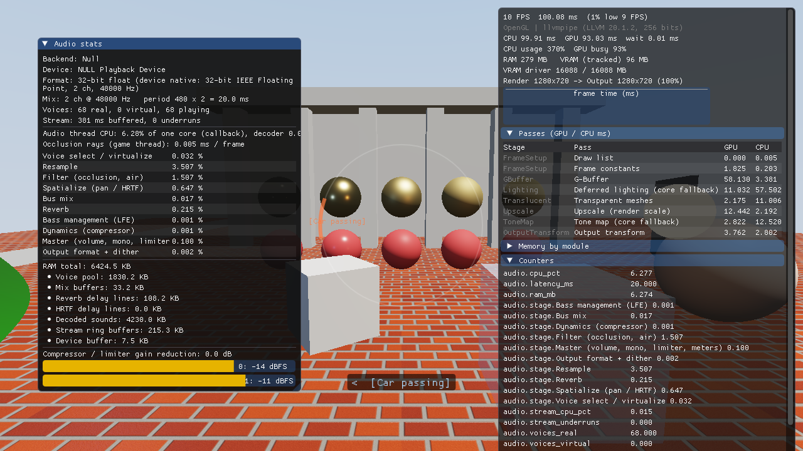

# Audio: overview

> Menu: **Audio** tab (41 settings) · Owner module: `audio` · Code: `src/modules/audio/`
> Measured costs: [`docs/_measurements/audio.md`](_measurements/audio.md) (`tools/audio_bench`)



## Definition
Every game ships an audio options page next to its graphics page. This module implements a
complete game audio engine from scratch (only the device I/O and file decoding come from
[miniaudio](https://miniaud.io)), so each option in the menu maps to real code you can read,
measure and rebuild.

## How it works
Sound runs on its own thread, driven by the sound card. Every few milliseconds the device asks for
the next block of samples (`AudioSystem::onAudio`), and the mixer produces it:

```
game thread (60 fps)                         audio thread (every 10 ms at 480 frames / 48 kHz)
-----------------------------                ------------------------------------------------------------
play()/stop()/setVoicePosition()   ──lock──▶ sync: copy settings, listener, voice descs
listener = camera                             1. voice select: score every playing voice, keep the loudest
occlusion rays (round robin)                     N real, the rest virtual                (Max voices)
subtitles / captions timers                   2. per real voice:
                                                 fetch → resample (pitch, rate, Doppler)  (Resampling, Doppler)
                                                 low-pass (occlusion, air absorption)    (Occlusion, Air)
                                                 gain (distance)                         (Distance attenuation)
                                                 pan / VBAP / HRTF into its bus          (3D audio, Speakers)
                                                 reverb send
                                              3. buses × bus volume → master             (Volume sliders)
                                              4. reverb return                           (Reverb)
                                              5. LFE = low-pass(sum of mains)            (Speaker config)
                                              6. compressor                              (Dynamic range)
                                              7. master volume, background fade, mono,   (Master, Background,
                                                 balance, safety limiter, meters          Accessibility)
                                              8. float → s16/s24/f32 (+ TPDF dither)      (Bit depth)
                                              → device buffer (period × periods)          (Buffer size)
disk ─▶ decoder thread ─▶ ring buffer ───────▶ music / dialogue streams                   (Streaming buffer)
```

The audio thread never blocks: it `try_lock`s the shared state and, if the game thread holds it,
mixes with last block's copy. Settings that change buffer sizes (device, speakers, sample rate, bit
depth, buffer size, max voices, reverb quality, HRTF, stream buffer) restart the device, which takes
about 50–150 ms; everything else applies on the next block.

## Breakdown

| Setting | Doc | Stage it lives in | Thread |
|---|---|---|---|
| Master / Music / SFX / Voice / Ambience / Interface volume, Mute | [audio_volume_mixing](audio_volume_mixing.md) | Bus mix, Master | audio |
| Output device | [audio_output_device](audio_output_device.md) | device | game (restart) |
| Speaker configuration, LFE crossover | [audio_speaker_config](audio_speaker_config.md) | Spatialize, Bass management | audio |
| Sample rate, Bit depth, Dither | [audio_sample_rate_bit_depth](audio_sample_rate_bit_depth.md) | everything / Output | audio |
| Max voices | [audio_quality_voices](audio_quality_voices.md) | Voice select | audio |
| Resampling quality | [audio_resampling](audio_resampling.md) | Resample | audio |
| 3D audio (pan / VBAP / HRTF) | [audio_spatial_hrtf](audio_spatial_hrtf.md) | Spatialize | audio |
| Distance attenuation, Rolloff, Air absorption | [audio_distance_attenuation](audio_distance_attenuation.md) | Spatialize, Filter | audio |
| Doppler effect, Doppler strength | [audio_doppler](audio_doppler.md) | Resample (pitch) | audio |
| Sound occlusion | [audio_occlusion](audio_occlusion.md) | rays: game; filter: audio | both |
| Reverb quality, level, room size, damping | [audio_reverb](audio_reverb.md) | Reverb | audio |
| Dynamic range (night mode) | [audio_dynamic_range](audio_dynamic_range.md) | Dynamics | audio |
| Audio buffer size, Buffer count | [audio_buffer_latency](audio_buffer_latency.md) | device | audio |
| Streaming buffer | [audio_streaming_buffer](audio_streaming_buffer.md) | decoder thread | decoder |
| Audio in background, Background volume | [audio_background](audio_background.md) | Master / device | audio |
| Mono audio, Balance, Visualize sound effects | [audio_accessibility](audio_accessibility.md) | Master / UI | audio / UI |
| Subtitles, Closed captions, Speaker names, Size, Background | [audio_subtitles](audio_subtitles.md) | UI | game |

## Optimization
How CPU and RAM are measured:

- **CPU** is the audio thread's busy time divided by the duration of audio it produced, i.e.
  "% of one core". At 6% the mixer needs 0.6 ms to produce 10 ms of sound. Each stage is timed
  separately with `steady_clock` and shown in the **Audio stats** window (Debug → Audio stats window)
  and as profiler counters `audio.cpu_pct`, `audio.stage.*`. This runs on the device thread, so the
  module reports it through `Module::offThreadCpuMs()` (audio CPU % × frame time), which the profiler
  adds to frame CPU ms: the menu's per-setting Δ CPU ms and `--bench-settings` include audio.
- **RAM** is every buffer the module allocates, by category: voice pool, mix buffers, reverb delay
  lines, HRTF delay lines, decoded sounds, stream ring buffers, device buffer
  (`Module::cpuMemoryBytes()` and counter `audio.ram_mb`).
- **GPU / VRAM**: zero for every audio setting.

Baseline cost (High preset, stereo 48 kHz, 69 voices) on the cloud container: **≈6.3% of one core,
2.1 MB of mixer RAM + 4.1 MB of decoded demo sounds**. The biggest levers, from the bench:

| Lever | Range measured | CPU (% of 1 core) | RAM |
|---|---|---|---|
| Max voices (305 playing) | 16 → 256 | 1.7 → 23.2 | 0.7 → 5.0 MB |
| Quality preset | Low → Ultra | 2.1 → 6.6 | 0.8 → 3.9 MB |
| 3D audio | VBAP → HRTF | 6.4 → 10.0 | +48 KB |
| Sample rate | 22 → 96 kHz | 4.4 → 10.2 | +0.2 MB |
| Buffer size | 4096 → 64 frames | 6.7 → 8.4 | ≈ same |
| Air absorption | off → on | 5.0 → 6.5 | 0 |
| Background | keep playing → pause device | 6.7 → 0.2 | 0 |

Repeat runs vary by about ±0.4 percentage points; settings below that (Doppler, attenuation
curves, mono, bit depth) are effectively free, which the "Own stage CPU" column confirms.

## Rebuild
1. Open the device with a callback (WASAPI / CoreAudio / ALSA, or a wrapper like miniaudio, SDL,
   PortAudio). Ask for float, your channel count, and a small period.
2. Keep two copies of game state: what the game wants (voice descriptions written on the game
   thread) and what the mixer uses (copied in at the top of each callback without blocking).
3. Implement the stages above in that order. Mix in planar float, convert to the device format once
   at the end.
4. Time every stage, track every allocation, and expose both: audio bugs are almost always "this
   got expensive" or "this ran late".
5. Build an offline harness (here `tools/audio_bench`) that calls the mixer without a device, so
   you can measure and listen (`--wav out.wav`) deterministically.

Files: `src/modules/audio/audio_module.cpp` (menu + overlay), `audio_system.*` (device, API),
`audio_mixer.*` (pipeline), `audio_dsp.*` (filters, resamplers, panning, reverb, compressor),
`audio_stream.*` (disk streaming), `audio_synth.*` (procedural test sounds), `audio_demo.*`
(demo soundscape), `tools/audio_bench/`.
