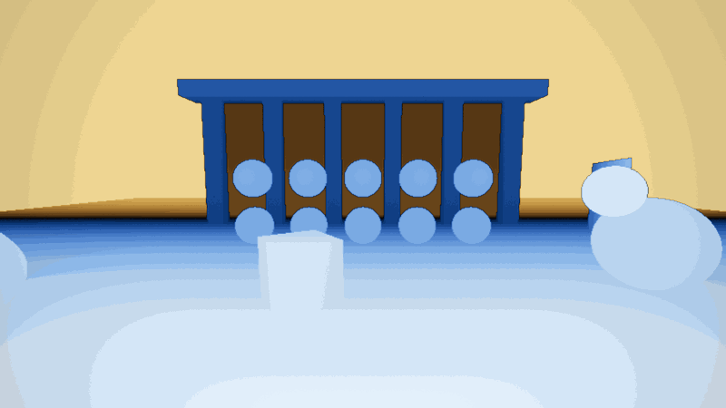

# Depth of Field (Bokeh)

> Menu: **Post Processing → Depth of Field** · Setting id(s): `post.dof`, `post.dof.autofocus/focus/fstop/focal/maxBlur/bokehBoost` · Owner module: `post`
> Values: On/Off; bokeh samples 22/43/71/110 from `post.quality` · Presets: Off by default (gameplay choice)

## Definition

A real lens can only be perfectly focused at one distance. Objects nearer or
farther than that are projected onto the sensor as a disc instead of a point,
so they appear blurred. That disc is the **circle of confusion (CoC)**. Depth
of field is the range that looks acceptably sharp. **Bokeh** is the look of the
out-of-focus blur: bright points become discs or polygons shaped like the
aperture blades, instead of a soft Gaussian smear.

## How it works

1. **Linearize depth.** Depth is stored non-linearly (and reversed-Z in this
   engine: near = 1, far = 0). View distance:
   `z = near / depth` for the infinite reversed-Z projection this engine uses
   (`linearDepth()` in `common/frame.glsl`); with a finite far plane it is
   `z = near*far / (near + depth*(far-near))`.
2. **Compute CoC per pixel** with the thin-lens equation:
   `CoC(mm) = |A · f · (z − F)| / (z · (F − f))`
   with aperture diameter `A = f / N` (focal length over f-stop), focus
   distance `F`. Convert to pixels using the sensor height (24 mm for full
   frame) and screen height, then clamp to the max radius. The sign is kept:
   negative = near field (in front of focus), positive = far field.
3. **Downsample** color + CoC to half resolution (blur does not need detail).
   Weight by CoC to stop sharp in-focus pixels from leaking into blurred areas.
4. **Bokeh gather.** For each pixel, sample a disc of points (golden-angle
   spiral or concentric rings, 16–64 samples) scaled to the max radius. Each
   sample contributes only if *its own* CoC is large enough to reach the
   center pixel (`sampleCoC >= distance`). This "scatter-as-gather" trick
   makes a blurry background pixel spread onto its neighbors while a sharp
   foreground pixel does not. Bright samples are weighted up slightly so
   highlights form crisp bokeh discs.
5. **Near-field handling.** Out-of-focus foreground must blur *over* sharp
   background (its edge spreads). The near CoC is dilated (max filter) before
   gathering so foreground blur bleeds outward.
6. **Tent filter + composite** at full res: blend the blurred image over the
   sharp one by `smoothstep` of |CoC|.
7. **Auto focus** reads the depth at the screen center (a small 1×1 pass) and
   smooths it over time, like a camera's focus motor.

## Breakdown

| Pass | Shader | Res |
|---|---|---|
| CoC | `dof_coc.frag` | full (R16F, signed pixels) |
| Prefilter (downsample color × CoC) | `dof_prefilter.frag` | 1/2 |
| Bokeh gather | `dof_bokeh.frag` | 1/2 |
| Postfilter tent | `dof_postfilter.frag` | 1/2 |
| Composite | `dof_composite.frag` | full |

Runs in the **PostRender** stage (render resolution, before the upscaler), since
it needs depth that matches the color buffer pixel-for-pixel.

Debug view (`post.debug` = DoF circle of confusion): blue = near field, orange = far field, brighter = bigger blur.



## Optimization

- Half-res gather is 4× cheaper; 22 samples (Low) / 43 (High) / 71 (Ultra).
- Skip the gather for tiles with max CoC < 0.5 px (tile classification with a
  16×16 min/max CoC buffer; the AAA approach used in UE4 "Circle DOF" and
  Frostbite).
- Separate near and far layers at lower res for the cheap "Gaussian" mode.
- Sample count in a spiral with golden angle (2.39996 rad) gives good coverage
  with no visible ring pattern.

Measured cost at 1920×1080 (`gfxlab --bench-settings`, post settings only, High preset baseline, 60-frame windows), GPU: **Mesa llvmpipe (LLVM 20.1.2, 256 bits), a CPU software rasterizer in the cloud container**. A frame takes ~250 ms there, so treat these as relative costs only and expect about ±8 ms of run-to-run noise: anything smaller than that is "free". Δ VRAM is 0 because the module allocates its targets at startup/resize regardless of the toggle. Re-run on a real GPU for absolute numbers.

| Setting | Value | Δ GPU ms | Δ CPU ms | Δ VRAM MB | Δ RAM MB |
|---|---|---|---|---|---|
| `post.dof` | Off | -5.6 | -5.0 | +0.0 | n/a |
| `post.dof` | On | +127.7 | +128.2 | +0.0 | n/a |

## Rebuild (from scratch)

1. CoC pass:
   ```glsl
   float d = texture(uDepth, uv).r;           // reversed-Z
   float z = uNear / max(d, 1e-7);            // infinite reversed-Z -> meters
   float A = uFocal / uFStop;                 // mm
   float coc = A*uFocal*(z*1000.0-uFocus*1000.0) / (z*1000.0*(uFocus*1000.0-uFocal));
   coc = coc / uSensorHeight * uScreenH;      // mm → px
   outCoC = clamp(coc, -uMaxRadius, uMaxRadius);
   ```
2. Downsample: average 4 texels, store `rgb` and `coc` in RGBA16F.
3. Gather:
   ```glsl
   for (int i=0;i<N;i++){
     float r = sqrt((i+0.5)/N) * uMaxRadius;
     float a = i * 2.39996;
     vec2 o = vec2(cos(a), sin(a)) * r;
     vec4 s = texture(uHalf, uv + o*texel);
     float w = smoothstep(r-1.0, r+1.0, abs(s.a));
     acc += vec4(s.rgb,1)*w;
   }
   result = acc.rgb/max(acc.a,1e-4);
   ```
4. Composite: `mix(sharp, blurred, smoothstep(0.5, 2.0, abs(coc)))`.
5. D3D11: identical HLSL; the CoC pass can be fused into the downsample.

Files: `src/modules/post/post_module.cpp` (runDof), `shaders/post/focus.frag`, `shaders/post/dof_prefilter.frag`, `shaders/post/dof_bokeh.frag`, `shaders/post/dof_postfilter.frag`, `shaders/post/dof_composite.frag`
