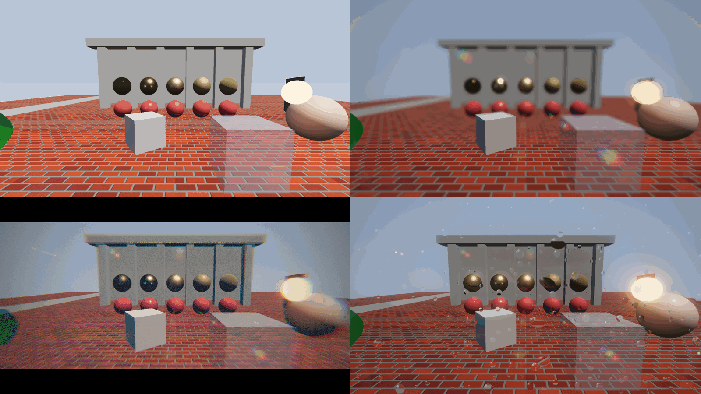

# Post-Processing Pipeline (Overview)

> Menu: **Post Processing → Pipeline** · Setting id(s): `post.enabled`, `post.quality`, `post.debug` · Owner module: `post`
> Values: Post-processing On/Off; quality Low / Medium / High / Ultra · Presets: quality Low=Low, Medium=Medium, High=High, Ultra=Ultra

## Definition

Post-processing is every image operation that runs *after* the 3D scene has been
rasterized (or ray traced) into an image, and *before* the UI is drawn. It works
in screen space: its inputs are full-screen textures (HDR color, depth, motion
vectors), its outputs are new full-screen textures. It is how a renderer turns a
physically plausible but "raw" radiance buffer into a picture that looks like it
came out of a camera: exposure, lens effects (bloom, flares, depth of field),
shutter effects (motion blur), sensor/film effects (grain, chromatic
aberration, vignette) and finally the mapping from unlimited HDR light values to
the 0..1 range a monitor can show (tonemapping, color grading, gamma).



*Top left: post-processing off. Top right: depth of field (focus 4 m, f/1.4). Bottom left: chromatic aberration, film grain, 2.39:1 letterbox, strong vignette, teal-and-orange split tone. Bottom right: rain on the lens + heat haze. Bloom, lens flare, eye adaptation and ACES are on in the three processed shots. Rendered with llvmpipe at 1600×900.*

## How it works

1. **The scene renders to an HDR target.** Lighting writes linear radiance into
   an `RGBA16F` texture (values can be 0.001 or 50 000, no clamping). Depth is
   kept in a sampleable depth texture. The velocity pass (or TAA) writes
   per-pixel screen-space motion in an `RG16F` texture.
2. **A chain of full-screen passes runs.** Each pass draws one triangle that
   covers the screen, its fragment shader reads one or more textures, and it
   writes to a render target. Many passes run at half or quarter resolution
   because blurry effects do not need full detail.
3. **Order matters.** The engine runs post-processing in four stages
   (see `docs/MODULE_API.md`); this module adds passes to each:

   | Stage | # | Pass | Space | Resolution |
   |---|---|------|-------|-----------|
   | PostRender | 1 | Heat haze / distortion | HDR linear | render |
   | PostRender | 2 | Depth of field (CoC, bokeh gather, composite) | HDR | render, gather at 1/2 |
   | PostRender | 3 | Motion blur (tile max, neighbor max, gather) | HDR | render |
   | (core/AA) | – | TAA / DLSS / FSR upscale to output res | HDR | output |
   | PostOutput | 4 | Panini projection | HDR | output |
   | PostOutput | 5 | Eye adaptation: average log-luminance + temporal adapt | HDR | 1/4 → 1×1 |
   | PostOutput | 6 | God rays (occlusion mask + radial blur) | HDR | 1/2 |
   | PostOutput | 7 | Bloom (prefilter, down chain, up chain) | HDR | 1/2 … 1/128 |
   | PostOutput | 8 | Lens flare / sun glare (ghosts, halo, starburst) | HDR | 1/2 |
   | PostOutput | 9 | Composite: scene + bloom·(1+dirt) + flare + rays, lens rain | HDR | output |
   | ToneMap | 10 | Exposure + tonemap (ACES / AgX / Reinhard / Hable), HDR peak | HDR → linear 0..1 | output |
   | PostLDR | 11 | Chromatic aberration, color grading LUT, vignette, film grain, letterbox | linear 0..1 | output |
   | (core) | – | Gamma / brightness / sRGB or PQ encode, then UI | display | output |

   Rules that fix the order: anything that simulates *light in the world or
   in the lens* (DoF, motion blur, bloom, flares) must run on linear HDR
   values, because a bright highlight must stay bright when blurred.
   DoF and motion blur run at render resolution *before* the upscaler,
   because they need depth and velocity that line up pixel-for-pixel with the
   color. Anything that simulates the *sensor or the display* (tonemap,
   grade, grain, gamma) runs last.
4. **"Uber" passes.** Cheap per-pixel effects are fused: one PostOutput
   composite, one tonemap pass, one PostLDR pass (CA + LUT + vignette +
   grain + letterbox), so the full-resolution image is read and written as few
   times as possible.

## Breakdown

| Component | File | Notes |
|---|---|---|
| Fullscreen triangle | `shaders/common/fullscreen.vert` + `PostModule::draw` | 3 vertices generated from `gl_VertexID`, no VBO, one `rhi` render pass per draw |
| Render targets | `RenderTargets::create("post.*", …, TargetScale::Render/Output, scale)` | auto-resized by the core (half-res DoF, 1/16 motion tiles, bloom mip chain…) |
| Settings | `PostModule::registerSettings` (ids `post.*`) | menu is generated; values uploaded once per frame into the `PostUBO` (binding 3) |
| Shaders | `shaders/post/*.frag` | one file per pass, shared `post/post_common.glsl` (PostUBO, hashes, noise) |
| GPU/CPU timers | core profiler, one timer per registered pass | shown in the overlay and next to each setting |

## Optimization

- **Fuse cheap passes** into the uber shader (done here). Each full-screen
  read+write at 1440p RGBA16F is ~30 MB of bandwidth.
- **Lower resolution** for blur-type effects: bloom, DoF, god rays, flares run
  at half resolution or less. The quality preset changes these scales.
- **Use bilinear filtering as free taps.** Sampling between 4 texels averages
  them in hardware, so a 13-tap downsample reads 36 texels.
- **Skip disabled passes** completely (no target clear, no draw).
- **Use `R11F_G11F_B10F`** instead of `RGBA16F` for bloom/flare chains when
  alpha is unused: half the bandwidth.
- **Compute shaders** (GL 4.3 / D3D11 CS) can do the eye-adaptation histogram
  and separable blurs with shared memory. This prototype stays on fragment
  shaders (GL 3.3) so it runs everywhere, including macOS.
- **Async compute** (D3D12/Vulkan) can overlap post work with the next frame's
  shadow pass.

Measured cost at 1920×1080 (`gfxlab --bench-settings`, post settings only, High preset baseline, 60-frame windows), GPU: **Mesa llvmpipe (LLVM 20.1.2, 256 bits), a CPU software rasterizer in the cloud container**. A frame takes ~250 ms there, so treat these as relative costs only and expect about ±8 ms of run-to-run noise: anything smaller than that is "free". Δ VRAM is 0 because the module allocates its targets at startup/resize regardless of the toggle. Re-run on a real GPU for absolute numbers.

| Setting | Value | Δ GPU ms | Δ CPU ms | Δ VRAM MB | Δ RAM MB |
|---|---|---|---|---|---|
| `post.enabled` | Off | -75.4 | -76.8 | +0.0 | n/a |
| `post.enabled` | On | +0.3 | +1.3 | +0.0 | n/a |
| `post.quality` | Low | +2.6 | +3.0 | +0.0 | n/a |
| `post.quality` | Medium | +1.0 | +1.4 | +0.0 | n/a |
| `post.quality` | High | +0.1 | +0.1 | +0.0 | n/a |
| `post.quality` | Ultra | +2.2 | +1.3 | +0.0 | n/a |

## Rebuild (from scratch)

1. Create an HDR FBO: `glTexImage2D(GL_TEXTURE_2D, 0, GL_RGBA16F, w, h, 0, GL_RGBA, GL_HALF_FLOAT, 0)`
   plus a `GL_DEPTH_COMPONENT24` texture. Render the scene into it.
2. Make an empty VAO and a vertex shader that outputs a big triangle:
   ```glsl
   out vec2 vUV;
   void main(){ vec2 p = vec2((gl_VertexID<<1)&2, gl_VertexID&2);
                vUV = p; gl_Position = vec4(p*2.0-1.0, 0, 1); }
   ```
   `glDrawArrays(GL_TRIANGLES, 0, 3)` now runs your fragment shader once per pixel.
3. Write a "copy" fragment shader that samples the HDR texture and writes
   `pow(color/(1+color), vec3(1/2.2))` to the default framebuffer: you now have
   the minimal tonemapped pipeline.
4. Add passes one at a time, each with its own FBO, in the order of the table
   above. Keep a `ping`/`pong` pair of full-res HDR targets for passes that
   read and write the same image (DoF, motion blur).
5. Move every per-pixel effect into the final pass once they work.
6. **Direct3D 11 equivalent:** `ID3D11Texture2D` with
   `DXGI_FORMAT_R16G16B16A16_FLOAT`, bound as both RTV and SRV; fullscreen
   triangle via `SV_VertexID`; the GLSL in `shaders/post` maps 1:1 to HLSL
   (`texture()` → `Tex.Sample(Samp, uv)`, `vec3` → `float3`, `mix` → `lerp`,
   `fract` → `frac`).

Files: `src/modules/post/post_module.cpp`, `src/modules/post/post_params.h`, `shaders/post/post_common.glsl` (all passes)
