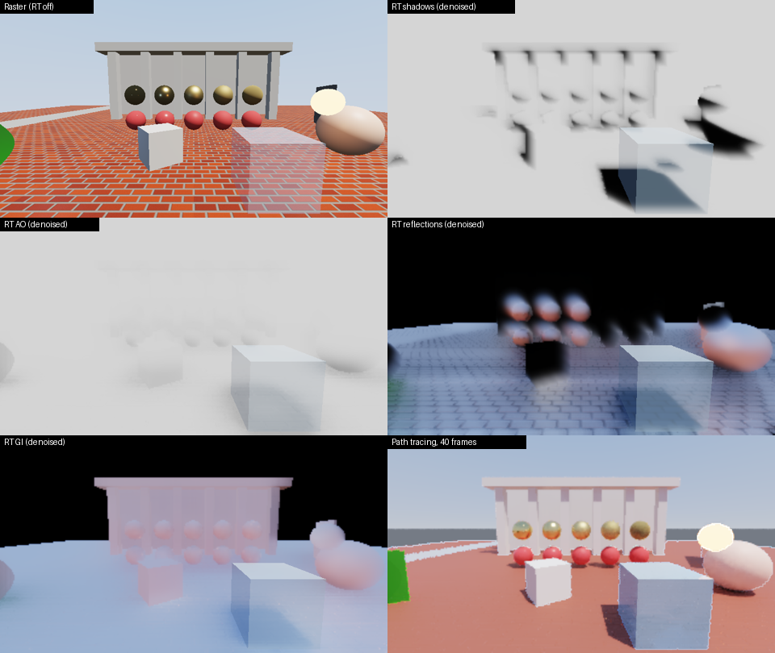

# Ray Tracing Foundation (BVH, DXR, compute fallback)

Every ray-traced setting in this app (RT shadows, RT reflections, RT AO, RT GI,
path tracing) sits on the same foundation: an acceleration structure over the
scene's triangles and a way to shoot rays against it from the GPU. This page
explains that shared layer. Read it before the per-setting pages.



*Demo scene, Mesa llvmpipe: raster, then each RT effect's denoised buffer (Ray Tracing → RT Debug View), then path tracing.*

## Definition

**Ray tracing** answers one question very fast: *"if I shoot a ray from point P
in direction D, what is the first triangle it hits (or does it hit anything
before distance T)?"* Rasterization answers "which triangle covers this pixel
from the camera"; ray tracing answers it from **any** point in **any**
direction, which is what shadows, reflections, AO and bounce light need.

Two query types:

| Query | Question | Used by |
|---|---|---|
| **Closest hit** | First surface along the ray, with barycentrics so you can shade it | Reflections, GI, path tracing |
| **Any hit / occlusion** | Is there *anything* before `tMax`? Stop at the first hit | Shadows, AO |

Occlusion rays are 2-3x cheaper because traversal stops early.

## How it works

### 1. Acceleration structure (BVH)

Testing a ray against every triangle is O(N). A **Bounding Volume Hierarchy**
puts triangles in a tree of axis-aligned boxes. A ray that misses a box skips
everything inside it, so traversal is roughly O(log N).

DXR and Vulkan split it in two levels:

- **BLAS** (bottom level): one per mesh, built over that mesh's triangles in
  object space. Built once for static meshes.
- **TLAS** (top level): one per frame, built over *instances* (BLAS pointer +
  4x3 transform + mask + hit-group offset). Moving an object only changes its
  instance transform, so the TLAS rebuild is cheap (hundreds of instances, not
  millions of triangles).

### 2. How it maps to D3D12 DXR / hardware RT (documented, not coded)

The prototype ships OpenGL 4.5 and D3D11 backends, neither of which has a
hardware ray tracing API, so the **compute BVH below is the real
implementation on both**. This section is how the same passes would map onto
DXR (D3D12) or Vulkan RT if a D3D12 backend is added.

```
ID3D12Device5::GetRaytracingAccelerationStructurePrebuildInfo
  -> allocate scratch + result buffers (UAV, D3D12_RESOURCE_STATE_RAYTRACING_ACCELERATION_STRUCTURE)
ID3D12GraphicsCommandList4::BuildRaytracingAccelerationStructure (BLAS per mesh)
  -> UAV barrier
BuildRaytracingAccelerationStructure (TLAS from D3D12_RAYTRACING_INSTANCE_DESC[])
```

Then either:

- **DXR 1.0 pipeline**: a state object with `raygeneration`, `miss` and
  `closesthit`/`anyhit` shaders plus a **shader binding table** (SBT). Launch
  with `DispatchRays`. Flexible (per-material hit shaders) but more plumbing.
- **DXR 1.1 inline ray tracing** (`RayQuery<>` in any shader, SM 6.5): you call
  `TraceRayInline` from a normal compute or pixel shader. No SBT, no state
  object. Inline RayQuery is the natural port for this app because every
  effect is a compute pass that reads the G-buffer: only the bodies of
  `traceAny()` / `traceClosest()` change.

```hlsl
RayQuery<RAY_FLAG_ACCEPT_FIRST_HIT_AND_END_SEARCH | RAY_FLAG_SKIP_CLOSEST_HIT_SHADER> q;
q.TraceRayInline(gScene, RAY_FLAG_NONE, 0xFF, ray);
q.Proceed();
bool occluded = q.CommittedStatus() == COMMITTED_TRIANGLE_HIT;
```

Feature check at startup:

```cpp
D3D12_FEATURE_DATA_D3D12_OPTIONS5 o5{};
dev->CheckFeatureSupport(D3D12_FEATURE_D3D12_OPTIONS5, &o5, sizeof o5);
bool dxr11 = o5.RaytracingTier >= D3D12_RAYTRACING_TIER_1_1;
```

Even with a D3D12 backend you'd keep the compute BVH as the fallback when DXR
1.1 is missing (GTX 10-series, older iGPUs, WARP).

Hardware RT moves two things into fixed-function units: box/triangle
intersection and BVH traversal (RT cores on NVIDIA, Ray Accelerators on AMD,
RTUs on Intel Arc). That's the 3-10x speed-up. Shading, sampling and
denoising stay on the shader cores, so everything else on these pages is the
same.

### 3. The real implementation: compute-shader BVH (GL 4.5 + D3D11)

Neither OpenGL nor D3D11 has a ray tracing API (`GL_NV_ray_tracing` never
shipped for GL in practice). So the app builds a BVH **on the CPU** and
uploads it as storage buffers (SSBOs in GL, StructuredBuffers in D3D11):

- SSBO 0: `BVHNode[]` – `vec4 bminLeftOrFirst; vec4 bmaxCount;`
  (32 bytes; `count == 0` means interior node whose children are
  `left` and `left+1`, otherwise a leaf with `count` triangles from `first`).
- SSBO 1: `Tri[]` – three positions (world space), packed as `vec4`s.
- SSBO 2: `TriAttr[]` – three normals + material index.
- SSBO 3: `Material[]` – albedo, roughness, metallic, emissive.

The GLSL compute shader walks the tree with a small fixed stack (32 entries is
plenty for a BVH of depth < 32), testing the nearer child first.

Ray/box: the **slab test**. Ray/triangle: **Möller-Trumbore**. Both are in
`src/modules/raytracing/shaders/rt_common.glsl` and mirrored in
`rt_common.hlsli`.

### 4. BVH build (CPU, SAH binned)

1. Compute each triangle's AABB and centroid.
2. Recursive split: for the longest axis, drop centroids into 12 bins, then
   evaluate the **Surface Area Heuristic** for each of the 11 split planes:
   `cost = A_left * N_left + A_right * N_right` (area = probability a random
   ray hits the box). Pick the cheapest. If no split beats `N * 1` (making a
   leaf), stop.
3. Store the two children of every interior node next to each other
   (`left`, `left+1`), so a node only needs one child index and stays 32 bytes.

A binned SAH BVH traces ~2x faster than a median split for the same scene.

## Breakdown (cost per frame, 1080p, mid GPU, compute fallback)

| Stage | Cost | Notes |
|---|---|---|
| BVH build (static scene) | once, ~5 ms / 100k tris on CPU | Not per frame |
| TLAS refit (DXR) | 0.05-0.2 ms | Per frame if anything moves |
| 1 occlusion ray / pixel | 0.6-1.5 ms | Shadows, AO |
| 1 closest-hit ray / pixel + shade | 1.5-4 ms | Reflections, GI |
| Path tracing, 1 spp, 3 bounces | 6-20 ms | Needs accumulation / denoise |

With hardware RT (RTX/RDNA2+), divide ray costs by roughly 3-10x.

## Optimization

- **Ray budget, not effects, is the knob.** Expose per-effect rays-per-pixel
  and a global **RT resolution scale** (trace at half res, upsample).
- **Occlusion rays where you can** (`ACCEPT_FIRST_HIT_AND_END_SEARCH`).
- **Short `tMax`** for AO (0.5-2 m) – most of the BVH is never touched.
- **Instance masks** to skip particles/foliage for some ray types.
- **Opaque flag** on geometry (`D3D12_RAYTRACING_GEOMETRY_FLAG_OPAQUE`) so the
  any-hit shader is never invoked; alpha-tested foliage is the most expensive
  thing in RT.
- **Compact BLAS** after build (`POST_BUILD_INFO_COMPACTED_SIZE`) – 50% memory.
- **Refit instead of rebuild** for deforming meshes (`ALLOW_UPDATE` +
  `PERFORM_UPDATE`); rebuild every N frames to fix quality decay.
- **Ray coherence**: sort/bin rays by direction (or use SER on Ada GPUs:
  `NvReorderThread`) so neighbouring threads walk the same nodes.
- **Blue-noise / R2 sampling** per pixel so 1 spp noise is easier to denoise.

## Conventions in this codebase

Reversed-Z depth (near = 1, far = 0), D3D-style clip space (z in 0..1,
`glClipControl(GL_UPPER_LEFT, GL_ZERO_TO_ONE)`), uv (0,0) at top-left. World
position from depth: `ndc = vec3(uv.x*2-1, 1-uv.y*2, depth)`,
`world = invViewProj * vec4(ndc,1)`, divide by w. Depth 0 means sky.

Code: `src/modules/raytracing/` (BVH, module, settings), `shaders/raytracing/`
(`rt_common.glsl` traversal + sampling, one compute shader per effect,
`rt_denoise_*.comp`).

## Rebuild (from scratch)

1. Gather all triangles in world space with normal + material index.
2. Build a binned-SAH BVH on the CPU (`bvh.cpp`, ~150 lines).
3. Flatten to an array of 32-byte nodes, upload nodes + triangles + materials
   as SSBOs (GL) or structured buffers (D3D12 fallback).
4. Write `traceClosest(ray, out hit)` and `traceAny(ray, tMax)` in a shared
   shader include: stack-based traversal, slab test, Möller-Trumbore.
5. (Optional, needs a D3D12 backend) with DXR 1.1: build a BLAS per mesh + a
   TLAS, bind the TLAS as an SRV (`RaytracingAccelerationStructure gScene :
   register(t0)`) and replace the body of `traceAny`/`traceClosest` with
   `RayQuery`.
6. Each effect is then a compute pass: read G-buffer depth+normal, reconstruct
   world position, generate rays, trace, write a result texture, denoise,
   composite.
