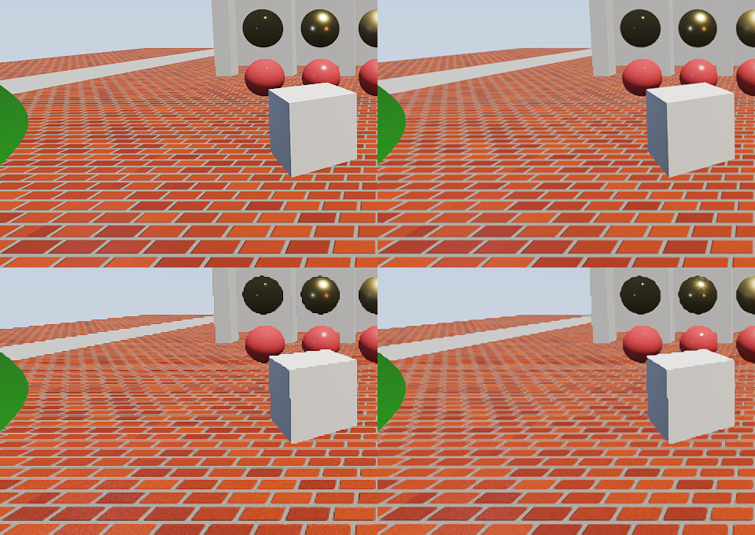

# Upscaling: DLSS, FSR, XeSS, TSR, NIS, DLAA and Render Scale

> Menu: **Anti-Aliasing & Upscaling → Upscaler, Upscaler Quality** · Setting id(s): `aa.upscaler`, `aa.upscale.quality` · Owner module: `aa.temporal`
> Values: Off / FSR 1-style / NIS-lite / Temporal TAAU / DLSS* / FSR 3* / XeSS* (*greyed out, SDK needed); Native AA 100% … Ultra Performance 33% · Presets: Low=TAAU Performance, Medium=TAAU Balanced, High/Ultra=Off (native)

Settings shown in the menu:
- `Upscaler: Off (Native) | Render Scale (bilinear) | FSR 1 (spatial) | NIS | Temporal (TAAU, our FSR2-style) | DLSS* | FSR 3* | XeSS*`
- `Quality Mode: Native AA (DLAA/FSR Native) | Quality 67% | Balanced 58% | Performance 50% | Ultra Performance 33% | Custom`
- `Render Scale %` (custom), `Upscaler Sharpness`

\* Vendor SDK entries appear only when the SDK is found at build time (see "Vendor SDKs" below). Otherwise the menu shows our educational implementations, labelled as such.

## Definition

Upscaling renders the 3D scene at a lower internal resolution and reconstructs an output-resolution image, trading a little image quality for a large frame-rate gain (shading cost scales with pixel count: 50% per axis = 25% of the pixels).

- **Spatial upscalers** use only the current low-res frame: bilinear render scale, FSR 1 (EASU + RCAS), NIS, CAS-scale. Fast, cannot invent detail that wasn't sampled.
- **Temporal upscalers** jitter the camera and accumulate samples from many frames at output resolution, like TAA but writing into a bigger history buffer: FSR 2/3, Unreal TSR, XeSS, DLSS 2+. They genuinely recover detail beyond the render resolution.
- **ML temporal upscalers** replace the hand-tuned history rejection/blending heuristics with a neural network: DLSS (NVIDIA tensor cores, CNN then transformer model in DLSS 4), XeSS (Intel XMX, plus a DP4a fallback on other GPUs), FSR 4 (RDNA 4).
- **DLAA / FSR Native AA / XeSS Native**: the same temporal pipeline at 100% scale, used purely as high-quality anti-aliasing.

## How it works

Common temporal upscaler pipeline (what FSR 2 publishes openly and what our `Temporal (TAAU)` implements):

1. **Jitter** with a Halton sequence. Number of phases grows with the upscale ratio: `phases = 8 * (output/render)^2` so every output pixel gets covered.
2. **Inputs at render resolution:** colour (HDR, pre-tonemap), depth, motion vectors, optional reactive mask (particles, transparency) and exposure.
3. **Reconstruct & dilate:** dilate depth and motion (closest-depth 3x3), build the previous-depth buffer for disocclusion detection.
4. **Depth clip / disocclusion:** reproject the previous depth; if the current surface wasn't visible last frame, distrust history there.
5. **Lock / thin-feature detection:** FSR "locks" pixels with thin, high-frequency luma features so they don't flicker.
6. **Accumulate at output resolution:** for each output pixel, find the render-res samples near it (accounting for jitter), weight them with a Lanczos-like kernel by their distance to the output pixel centre, and blend with the reprojected output-res history. Pixels whose current sample lands close to the centre get a large weight; far ones a small weight. That's how jitter turns into real extra resolution.
7. **History rectification:** clip history into the neighbourhood colour box (like TAA) with box size adapted to confidence.
8. **Sharpen** (RCAS) at output resolution.
9. **Mip bias:** textures sampled with `log2(render/output) - 1` bias (roughly) so detail exists to be accumulated.

**FSR 1 (EASU)** is different: a 12-tap edge-adaptive Lanczos that analyses local gradient direction and stretches the filter kernel along edges, then RCAS sharpening. One pass, no history.

**DLSS / XeSS:** feed the same inputs to the SDK; the network predicts the blend weights and output colour. Better at thin geometry, disocclusion and moiré than heuristics.

**TSR** (Unreal 5): temporal upscaler similar to FSR 2, with history kept at a higher-than-output resolution option and extra anti-flicker heuristics. It is engine-specific; we document it for comparison.

## Breakdown

Quality modes (per-axis scale, standard across DLSS/FSR/XeSS 1.3+):

| Mode | Scale | Pixels shaded | Output 4K renders at |
|---|---|---|---|
| Native AA (DLAA) | 100% | 100% | 3840x2160 |
| Ultra Quality (FSR1/XeSS) | 77% | 59% | 2954x1662 |
| Quality | 67% | 44% | 2560x1440 |
| Balanced | 58% | 34% | 2227x1253 |
| Performance | 50% | 25% | 1920x1080 |
| Ultra Performance | 33% | 11% | 1280x720 |

Render scale vs upscaler (the debug view `Upscale Compare` shows these side by side at the same internal resolution):

| Method at 50% | Detail | Stability | Cost |
|---|---|---|---|
| Bilinear render scale | blurry | shimmers | ~0 |
| FSR 1 / NIS | sharper edges, no new detail | shimmers | ~0.3 ms |
| Temporal (ours, FSR2-style) | near-native static, softer in motion | stable | ~0.8 ms at 4K |
| DLSS / XeSS XMX | near-native, best in motion | very stable | ~1 ms (tensor/XMX) |

Code:
- `src/modules/aa/temporal.cpp` (menu, render-scale request to the core, jitter phase count, mip bias)
- `shaders/aa/fsr1_easu.frag` + `shaders/aa/rcas.frag` (spatial, written from the public algorithm description)
- `shaders/aa/taau_accumulate.frag` (our temporal upscaler: dilation, Lanczos accumulation, colour-box clip and confidence in one pass)
- `src/modules/aa/vendor/` (`dlss_backend.cpp`, `ffx_backend.cpp`, `xess_backend.cpp`: stubs compiled only with `GFXLAB_WITH_DLSS` etc.)

## Vendor SDKs

| SDK | API support | Licence | Status in this prototype |
|---|---|---|---|
| DLSS (Streamline) | D3D11/12, Vulkan. **No OpenGL.** | NVIDIA RTX SDK licence | D3D backend hook only, needs the SDK + RTX GPU |
| FSR 2/3 (FidelityFX SDK) | D3D12, Vulkan; FSR 2.x had D3D11 + an open-source GLSL port | MIT | FSR 2 algorithm reimplemented educationally in GLSL; SDK hook for D3D |
| XeSS | D3D11 (1.3+), D3D12, Vulkan | Intel licence | D3D hook only |
| NIS | any (shader source, MIT) | MIT | `nis_lite.frag` simplified; full shader can be dropped in |

So on the OpenGL path, "DLSS" and "XeSS" are not available and the menu says so. That is the real-world situation, not a limitation of this lab.

## Optimization

- Run all post-processing that doesn't need full resolution (SSAO, SSR, volumetrics, DOF gather) at render resolution *before* the upscaler; run bloom, tone map, film grain, UI after at output resolution.
- Use the negative mip bias, otherwise textures look blurry no matter how good the upscaler is.
- Provide a reactive mask for particles and alpha-blended surfaces to avoid smearing.
- Feed HDR colour with exposure, and let the upscaler tonemap internally for weighting.
- Combine with **Dynamic Resolution** (`dynamic_resolution.md`): temporal upscalers handle a changing input size gracefully.
- Never upscale the UI; draw it at output resolution after everything.

In the app (960x540 output, demo scene): native TAA (top left), Temporal TAAU at 50% (top right), FSR 1-style EASU at 50% (bottom left), NIS-lite at 50% (bottom right). The spatial upscalers keep the brick edges jagged; the temporal one rebuilds them.



### Measured quality

Measured with `tests/aa/quality_test.py` (512x288 procedural scene: thin lines, a moving rotated square, HDR highlights; Mesa llvmpipe). PSNR against a 16x16 supersampled reference, higher is better.

Render at 50% per axis (25% of the pixels), output 512x288:

| Method | PSNR |
|---|---|
| Native, no AA (for scale) | 31.2 dB |
| Bilinear render scale | 27.9 dB |
| FSR 1-style EASU (ours) | 28.2 dB |
| Temporal TAAU (ours), static | 33.2 dB |
| Temporal TAAU (ours), moving 2 px/frame | 32.1 dB |

The temporal upscaler at 25% of the pixels beats native rendering without AA, which is the whole argument for DLSS/FSR 2+/XeSS. Spatial upscalers only slightly beat bilinear: they cannot invent missing samples. Kernel width, clip box (2.0 sigma) and minimum blend (0.02) in `temporal.cpp` were chosen from this test.

## Rebuild (from scratch)

Minimal temporal upscaler (TAAU), the core of `taau_accumulate.frag`:

```glsl
// one thread per OUTPUT pixel
vec2 outUV = (vec2(gid) + 0.5) / outSize;
// position of this output pixel in render-res texel space, removing jitter
vec2 rp = outUV * renderSize - 0.5 - jitterPixels;
ivec2 base = ivec2(floor(rp));
vec3 sum = vec3(0); float wsum = 0.0; vec3 m1 = vec3(0), m2 = vec3(0);
for (int y = -1; y <= 2; y++) for (int x = -1; x <= 2; x++) {
    ivec2 t = base + ivec2(x, y);
    vec3 c = toYCoCg(tonemapWeight(texelFetch(uColor, t, 0).rgb));
    vec2 d = (vec2(t) - rp) * (renderSize.x / outSize.x) ; // distance in OUTPUT pixels
    float w = lanczos2(length(d));
    sum += c * w; wsum += w; m1 += c; m2 += c * c;
}
vec3 cur = sum / max(wsum, 1e-4);
vec3 mu = m1 / 16.0, sd = sqrt(max(m2 / 16.0 - mu * mu, 0.0));
vec3 hist = toYCoCg(catmullRom(uHistory, outUV - velocityToUV(dilatedVelocity(outUV))));
hist = clamp(hist, mu - sd * 1.25, mu + sd * 1.25);
// confidence: how close the closest current sample is to this output pixel centre
float conf = clamp(wsum / 4.0, 0.0, 1.0);
float a = disoccluded ? 1.0 : mix(0.04, 0.2, conf);
vec3 outC = mix(hist, cur, a);
imageStore(uOut, gid, vec4(fromYCoCg(outC), 1));   // also becomes next frame's history
```

Steps:
1. Split render vs output resolution in the core; the scene and pre-upscale passes use render res.
2. Jitter with `phases = ceil(8 * ratio^2)` Halton points; apply mip bias.
3. Implement dilation + disocclusion (compare reprojected previous depth vs current depth).
4. Implement the accumulate pass above into an output-size ping-pong history.
5. RCAS sharpen.
6. Compare against bilinear render scale and FSR 1 at the same render scale.
